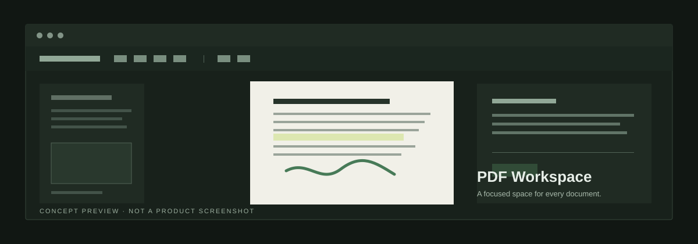

<!--
  PDF Workspace — project README
  The cover is an illustrative concept, not a screenshot of a released application.
-->

  

<h1 align="center">PDF Workspace</h1>

  <strong>Рабочее пространство для PDF. Ничего лишнего — всё необходимое.</strong>

  
  
  
  
  

  <a href="#русский">Русский</a> ·
  <a href="#english">English</a> ·
  <a href="#español">Español</a> ·
  <a href="https://github.com/German-GPD/pdf-workspace/issues">Issues</a> ·
  <a href="https://t.me/german_me">Связаться</a>

> [!IMPORTANT]
> **PDF Workspace находится на стадии проектирования.** Это описание целевого продукта и планируемых возможностей, а не список уже реализованных функций. Готовой сборки и скриншотов приложения пока нет.

---

## Русский

### О проекте

**PDF Workspace** — бесплатное настольное приложение для Windows, задуманное как единое пространство для чтения, организации и разметки PDF-документов.

В первую очередь проект ориентирован на учителей и учащихся: учебники, методические материалы, задания, конспекты и рабочие документы должны быть доступны в одном удобном месте.

Главный принцип — **документ занимает центральное место**. Интерфейс остаётся компактным, инструменты подстраиваются под пользователя, а рабочее состояние документа сохраняется между запусками.

### Что планируется

| Раздел | Возможности |
|---|---|
| **PDF Viewer** | Просмотр страниц, поиск по тексту, масштабирование, поворот, режим двух страниц |
| **Library** | Библиотека PDF, папки и коллекции, поиск, сортировка, избранное |
| **Recent files** | История открытых документов и быстрое продолжение чтения |
| **Annotations** | Ручка, маркер, выделение, ластик, фигуры, стрелки и текстовые заметки |
| **Bookmarks** | Закладки страниц с пользовательскими названиями |
| **Notes** | Заметки к документу, отдельной странице или собственной теме |
| **Export** | Экспорт размеченного документа в отдельную PDF-копию |
| **Workspace** | Запоминание страницы, масштаба и позиции чтения |
| **Appearance** | Светлая и тёмная темы, системный акцентный цвет Windows |
| **Updates** | Проверка обновлений и установка новых версий |

### Monic Control Bar

Фирменная адаптивная панель управления, которую планируется развивать как переиспользуемый компонент экосистемы German'$ GPD.

- **Своя конфигурация:** добавление, скрытие и перестановка кнопок.
- **Свободное отображение:** иконки, текст или иконки вместе с текстом.
- **Группы действий:** объединение инструментов по назначению.
- **Контекстные команды:** набор действий может меняться в зависимости от раздела.
- **Быстрый доступ:** редко используемые команды можно убрать в дополнительное меню.
- **Сброс:** возврат к стандартной конфигурации.

### Интерфейс и рабочее пространство

- Windows Native — визуальная основа интерфейса.
- Системный цвет акцента Windows.
- Светлая и тёмная темы; выбор при первом запуске и изменение в настройках.
- Компактные панели и тонкие разделители вместо тяжёлых карточек.
- Минимум пустого пространства — максимум места для страницы PDF.
- Боковые панели и миниатюры страниц открываются по необходимости.

**Планируемые режимы просмотра:**

1. **Обычный** — основные панели и инструменты доступны.
2. **Компактный** — боковые панели скрыты, документу отдано больше места.
3. **Фокус** — почти весь экран занимает PDF; интерфейс вызывается по необходимости.

### Работа с файлами

Предусматриваются два разных сценария:

- **Открыть файл** — PDF остаётся в исходной папке; приложение запоминает его в истории.
- **Добавить в библиотеку** — PDF копируется в управляемое хранилище приложения.

Удаление записи из библиотеки не должно случайно удалять исходный файл. Аннотации хранятся отдельно от оригинала, а экспорт создаёт новую PDF-копию.

Пользователь сможет выбрать расположение данных: стандартную папку документов, произвольный диск или переносимое хранилище.

### Архитектура и технологии

| Компонент | Назначение |
|---|---|
| **Tauri 2** | Desktop-оболочка и взаимодействие с Windows |
| **Rust** | Системная логика и операции с файлами |
| **WebView2** | Отображение интерфейса на Windows |
| **TypeScript** | Логика пользовательского интерфейса |
| **PDF.js** | Отображение и работа с содержимым PDF |
| **Canvas / SVG** | Слой аннотаций поверх страниц |
| **SQLite** | Метаданные, история, закладки и настройки |
| **Vite / Cargo** | Инструменты разработки и сборки |

Технологический стек предварительный. До реализации будут проверены совместимость компонентов, лицензии зависимостей и способ корректного экспорта аннотаций в PDF.

### Принципы проекта

- **Local-first** — документы и рабочие данные остаются под контролем пользователя.
- **Без обязательного аккаунта** — облачная учётная запись не является условием использования.
- **Оригинал в безопасности** — аннотации не должны незаметно перезаписывать исходный PDF.
- **Настраиваемость** — пользователь сам определяет удобный набор инструментов.
- **Компактность** — интерфейс не должен отнимать место у документа.
- **Прозрачность** — понятные релизы, список изменений и сведения о зависимостях.

### Дорожная карта

- [x] Создание репозитория и фиксация направления проекта.
- [x] Подготовка пользовательской лицензии PW-FUL.
- [ ] Уточнение требований и архитектуры.
- [ ] Проектирование интерфейса и Monic Control Bar.
- [ ] Подготовка базовой структуры приложения.
- [ ] Реализация библиотеки документов и PDF Viewer.
- [ ] Инструменты аннотаций и сохранение рабочего состояния.
- [ ] Экспорт аннотированных PDF.
- [ ] Настройки, локализация и проверка доступности.
- [ ] Тестирование, установщик и первый публичный релиз.
- [ ] Сайт проекта и документация.

Этапы могут меняться по мере разработки.

### Загрузка

<kbd>COMING SOON</kbd>

Установщик будет опубликован здесь после появления проверенной сборки:

- [GitHub Releases](https://github.com/German-GPD/pdf-workspace/releases)

Пока релизов нет — не скачивайте установщики из сторонних источников, выдаваемые за PDF Workspace.

### Участие и обратная связь

Идеи, предложения и сообщения об ошибках можно будет оставлять в [GitHub Issues](https://github.com/German-GPD/pdf-workspace/issues).

По вопросам сотрудничества, отдельным разрешениям и другим договорённостям:

**[Telegram · @german_me](https://t.me/german_me)**

### Лицензия

Проект распространяется по **[PDF Workspace Free Use License (PW-FUL)](LICENSE)**.

- Использование — бесплатно.
- Изучение и изменение исходного кода — разрешены.
- Распространение оригинальных и изменённых версий — бесплатно, с соблюдением лицензии и указанием автора.
- Продажа копий и модифицированных версий — запрещена.
- Добровольные донаты автору — разрешены.

---

## English

**PDF Workspace** is a planned free Windows desktop application for reading, organizing, and annotating PDF documents. Its primary audience is teachers and students.

### Planned features

- PDF viewer with text search, zoom, rotation, and two-page mode.
- Local document library, folders, collections, recent files, and favorites.
- Annotations: pen, highlighter, eraser, shapes, arrows, and text notes.
- Bookmarks and notes linked to documents and pages.
- Workspace restoration: last page, zoom level, and reading position.
- Export annotated documents as separate PDF copies.
- Light and dark themes with the Windows system accent color.
- Three workspace modes: Normal, Compact, and Focus.

### Monic Control Bar

A customizable adaptive toolbar: reorder, hide, group, and configure actions; choose icons, labels, or both; restore the default layout when needed.

### Planned technology

Tauri 2 · Rust · WebView2 · TypeScript · PDF.js · Canvas/SVG · SQLite · Vite.

The stack and dependency licenses are subject to review before implementation and release.

### Project status

**Planning stage — no public application build is available yet.** Features listed above describe the intended direction.

- [Roadmap and issues](https://github.com/German-GPD/pdf-workspace/issues)
- [Releases](https://github.com/German-GPD/pdf-workspace/releases)
- [License — PW-FUL](LICENSE)
- [Contact and cooperation](https://t.me/german_me)

---

## Español

**PDF Workspace** es una futura aplicación gratuita para Windows destinada a leer, organizar y anotar documentos PDF. Está pensada principalmente para docentes y estudiantes.

### Funciones previstas

- Visor PDF con búsqueda de texto, zoom, rotación y vista de dos páginas.
- Biblioteca local, carpetas, colecciones, archivos recientes y favoritos.
- Anotaciones: lápiz, resaltador, borrador, figuras, flechas y notas de texto.
- Marcadores y notas vinculados a documentos y páginas.
- Recuperación del estado de lectura: página, zoom y posición.
- Exportación de documentos anotados a una copia PDF independiente.
- Temas claro y oscuro con el color de acento de Windows.
- Modos Normal, Compacto y Enfoque.

### Monic Control Bar

Barra adaptable y personalizable: permite reordenar, ocultar y agrupar acciones, elegir iconos o etiquetas y restaurar la configuración inicial.

### Tecnologías previstas

Tauri 2 · Rust · WebView2 · TypeScript · PDF.js · Canvas/SVG · SQLite · Vite.

La arquitectura y las licencias de las dependencias se revisarán antes de la implementación.

### Estado del proyecto

**Fase de planificación: todavía no existe una versión pública de la aplicación.** Las funciones descritas representan los objetivos del proyecto.

- [GitHub Issues](https://github.com/German-GPD/pdf-workspace)
- [Descargas y versiones](https://github.com/German-GPD/pdf-workspace/releases)
- [Licencia — PW-FUL](LICENSE)
- [Contacto y colaboraciones](https://t.me/german_me)

---

  Designed with focus by <a href="https://github.com/German-GPD">German-GPD</a> · PDF Workspace

